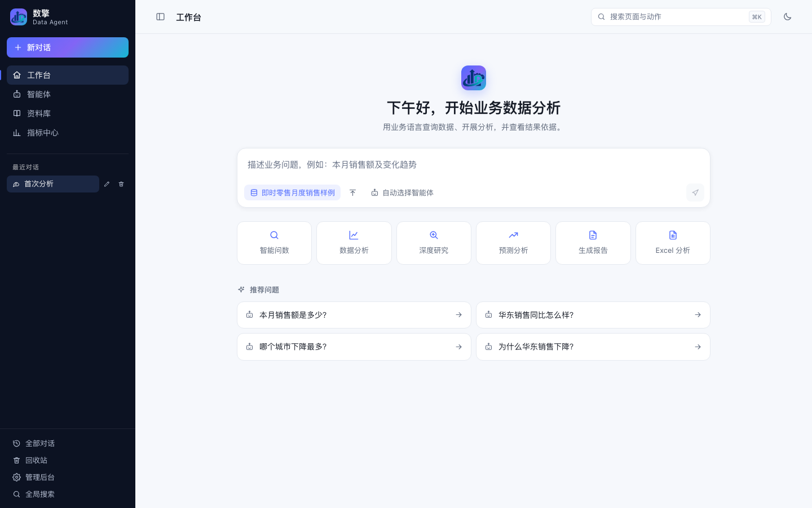
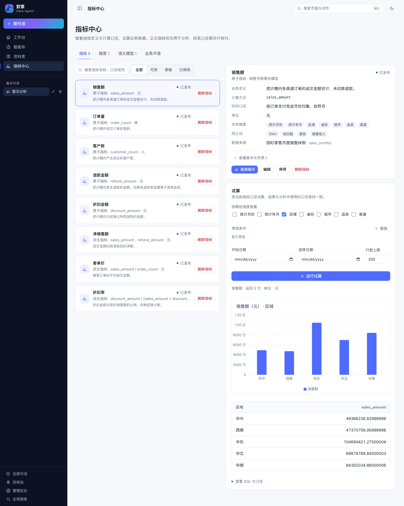
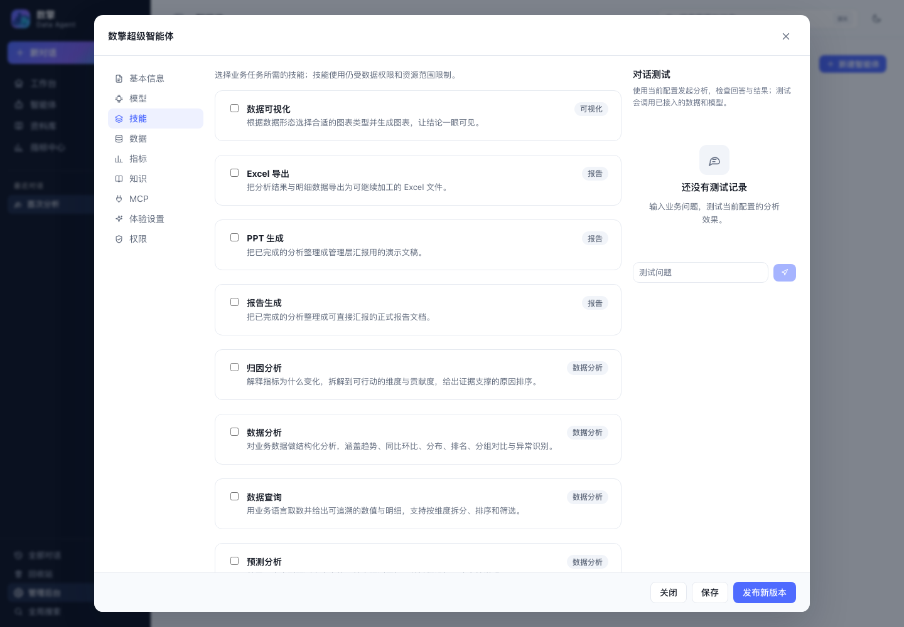

<div align="center">

# 数擎 Data Agent

**面向业务人员的数据分析智能体**

用自然语言查询业务数据，基于统一指标口径开展分析，生成可追溯的结论与报告。

[](https://github.com/fuyuxiang/data-agent/actions/workflows/ci.yml)


[产品预览](#产品预览) · [核心能力](#核心能力) · [快速开始](#快速开始) · [系统架构](#系统架构) · [文档](#文档) · [许可与贡献](#许可与贡献)

</div>

数擎将数据接入、指标语义、业务知识、技能执行和成果交付连接为一条分析链路。业务人员从工作台提问，在需要时确认分析范围，查看结论、图表及其依据；管理员维护数据权限、指标定义、模型服务和智能体配置。

当前支持单节点私有化部署，通过 OpenAI 兼容接口接入模型。自主分析需要配置可用的模型服务；数据浏览和指标试算可独立使用。项目尚未设置项目级开源许可证，详见[许可与贡献](#许可与贡献)。

## 产品预览

**工作台：从业务问题开始分析。** 提问入口、推荐问题与数据范围集中呈现，业务用户可按需选择智能体与技能。



<details>
<summary>指标中心：查看业务口径、按区域试算（展开截图）</summary>

查看业务定义、计算方式和支持维度，按正式指标口径试算。



</details>

<details>
<summary>智能体管理：配置技能、测试与发布（展开截图）</summary>

组合模型、技能、数据和知识，分别管理草稿与发布版本。



</details>

截图来自当前代码运行的真实界面，使用内置合成零售数据；指标图表由实际查询生成。截图未接入外部模型，不展示模型分析结论。[截图生成说明](docs/screenshots.md)

## 核心能力

| 能力 | 说明 |
| --- | --- |
| 自然语言分析 | 支持业务问数、趋势分析、变化贡献拆解与预测；复杂问题可先确认目标、时间和数据范围。 |
| 指标与业务知识 | 通过语义模型统一指标定义、公式、单位和维度，结合业务规则解释结果；探索性查询可按需读取数据结构。 |
| 技能与智能体 | 内置问数、分析、归因、预测、Excel 分析、可视化、深度研究、报告、PPT 和 Excel 导出 10 类技能，支持配置、测试与版本发布。 |
| 数据接入 | 支持文件、数据库和 HTTP API；数据库查询可下推筛选、关联与聚合，Doris / StarRocks 支持目录检索和有界探查。 |
| 结果核验与追溯 | 记录查询结果、执行过程与证据引用，在正式成果发布前检查完整性、来源范围和显式数字。 |
| 多格式交付 | 基于同一发布版本生成 Word、PPT、Excel、HTML 或图片，统一保存到资料库；导出复用已发布结果。 |
| 访问与执行控制 | 支持工作空间角色、数据源授权、行列权限、只读 SQL 校验、工具风险分级、凭据加密和审计记录。 |
| 外部能力扩展 | 通过 MCP 连接外部工具；可选接入已部署的 Trino 与 Livy / Spark 计算环境。 |

规则核验用于检查已实现的约束；业务解释、归因结论和建议仍需人工复核。功能范围与设计取舍见[产品边界](PRODUCT_SCOPE.md)。

## 快速开始

### 环境要求

- Python 3.11+（CI 使用 3.11）和 Git。
- Node.js 20+：用于前端开发、检查与生产构建；直接运行源码界面时无需安装。
- 连接 SQL Server 时，需要在运行主机安装 Microsoft ODBC Driver 18。

### 本地启动

macOS / Linux：

```bash
git clone https://github.com/fuyuxiang/data-agent.git
cd data-agent
python3 -m venv .venv
source .venv/bin/activate
python -m pip install --require-hashes -r requirements.lock
python app.py
```

Windows PowerShell：

```powershell
git clone https://github.com/fuyuxiang/data-agent.git
Set-Location data-agent
.\start-dataagent.bat
```

Windows 启动脚本自动创建虚拟环境、安装依赖并检查前端资源。也可使用 `py -3 -m venv .venv` 手动创建环境，再运行 `.\.venv\Scripts\python.exe` 安装依赖和启动 `app.py`。

打开 <http://127.0.0.1:5001>。默认仅监听本机；Windows 脚本遇到端口占用会选择可用端口，以终端输出为准。开发环境中的全新实例使用本地模式，生产环境需初始化系统所有者并登录。

### 体验演示数据

1. 在工作台点击「使用演示数据」，载入近 24 个月的合成零售数据、8 个正式指标和 4 条业务知识。
2. 打开「指标中心」，选择「销售额」，勾选「区域」并运行试算。这一步无需模型服务。
3. 在「管理后台 → 模型」配置 API Key、Base URL 和模型 ID，测试连接。
4. 回到工作台提问，按需确认范围，检查结果来源与口径，再生成报告或导出文件。

```text
本月销售额是多少？
华东销售同比怎么样？
为什么华东销售下降？
预测下个月销售额。
生成经营分析报告。
```

演示数据按首次载入月份生成，包含预设的经营变化，仅用于体验分析流程。详细使用说明、结果核验与回收站行为见[使用指南](docs/user-guide.md)。

## 系统架构

当前采用**模块化单体架构**：Vue 客户端通过 HTTP / SSE 访问 Flask 应用；Agent、技能解析、任务调度与业务服务运行在同一应用节点。本地分析使用受限子进程，模型、业务数据库和远端计算平台通过适配器连接。


图中框内为逻辑组件，实线表示主要调用或读写关系，虚线表示可选连接；标注协议的连线跨越进程或系统边界。并列组件不代表必须依次执行，图中省略部分内部调用与持久化连线。

| 设计 | 当前实现 |
| --- | --- |
| 统一执行入口 | `AgentLoop` 管理模型与工具调用循环；`Skill Runtime` 解析技能并限定可用能力，`ToolExecutor` 统一执行检查与记录。 |
| 计算贴近数据 | 原生数据库查询下推执行；本地统计分析只接收通过规模与完整性检查的数据，使用固定审核方法。大型计算需显式配置远端引擎。 |
| 发布前核验 | 正式成果通过来源、完整性、验证状态和数字证据检查后发布；各格式交付物读取同一发布版本。 |
| 本地持久化 | SQLite WAL 保存配置、任务、事件和审计；文件目录保存上传数据、知识索引与交付物。实例锁限制同一存储目录仅由一个应用实例使用。 |

**部署范围：**当前支持单节点运行。多副本部署需要改造控制存储、任务协调和文件存储。Trino、Livy / Spark 由部署方提供；模型与 MCP 的数据流向取决于实际连接配置。

组件到源码的对应关系、执行时序、业务数据流与数据库资源控制见[架构设计](docs/architecture.md)。

### 技术栈

| 领域 | 技术 |
| --- | --- |
| Web 客户端 | Vue 3、原生 ES Modules、ECharts；依赖随项目本地交付 |
| API 与任务运行时 | Flask、Waitress、SSE、进程内任务线程池 |
| 数据访问与分析 | SQLAlchemy、DuckDB、pandas、SciPy、scikit-learn、statsmodels、pmdarima |
| 元数据与文件 | SQLite WAL、本地文件系统 |
| 文档与表格交付 | python-docx、python-pptx、openpyxl |
| 可选能力 | MCP、Trino、Livy / Spark、PyTorch |

## 文档

| 文档 | 内容 |
| --- | --- |
| [使用指南](docs/user-guide.md) | 首次配置、分析流程、结果核验、导出与演示数据说明 |
| [架构设计](docs/architecture.md) | 组件职责、执行时序、数据流、数据库查询与扩展边界 |
| [部署与运维](docs/operations.md) | 环境变量、生产部署、健康检查、备份恢复与安全控制 |
| [开发指南](docs/development.md) | 代码目录、依赖安装、质量检查、浏览器测试与集成验证 |
| [截图维护](docs/screenshots.md) | 产品截图来源与重新生成方法 |
| [配置模板](.env.example) | 模型、网络、权限与资源限制等配置项 |
| [产品边界](PRODUCT_SCOPE.md) | 产品定位、模块职责与范围约束 |

本地开发可使用默认配置。生产部署需显式配置独立密钥、可信域名、出站白名单和 HTTPS 反向代理；`app.py` 不会自动读取 `.env` 文件，具体步骤见[部署与运维](docs/operations.md)。

## 许可与贡献

当前仓库**没有项目级 `LICENSE`**，尚未授予明确的开源使用、修改和分发许可。`backend/analysis_modules/` 与 `backend/data_cleaning/` 包含受第三方非商业条款约束的代码，具体声明见 [THIRD_PARTY_NOTICES.md](THIRD_PARTY_NOTICES.md)。复用、分发或商业使用需先核实授权。

欢迎通过 [Issues](https://github.com/fuyuxiang/data-agent/issues) 提交可复现的问题与改进建议。报告问题时请附环境、复现步骤、预期行为及脱敏日志；提交代码前请先通过 Issue 沟通，并确认贡献与授权规则。请勿提交真实业务数据、凭据或备份。
