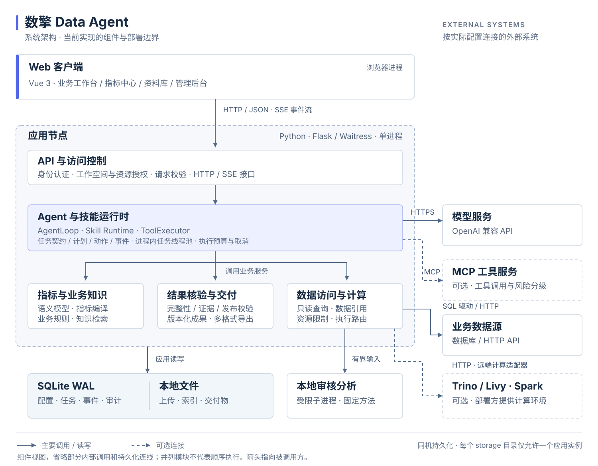
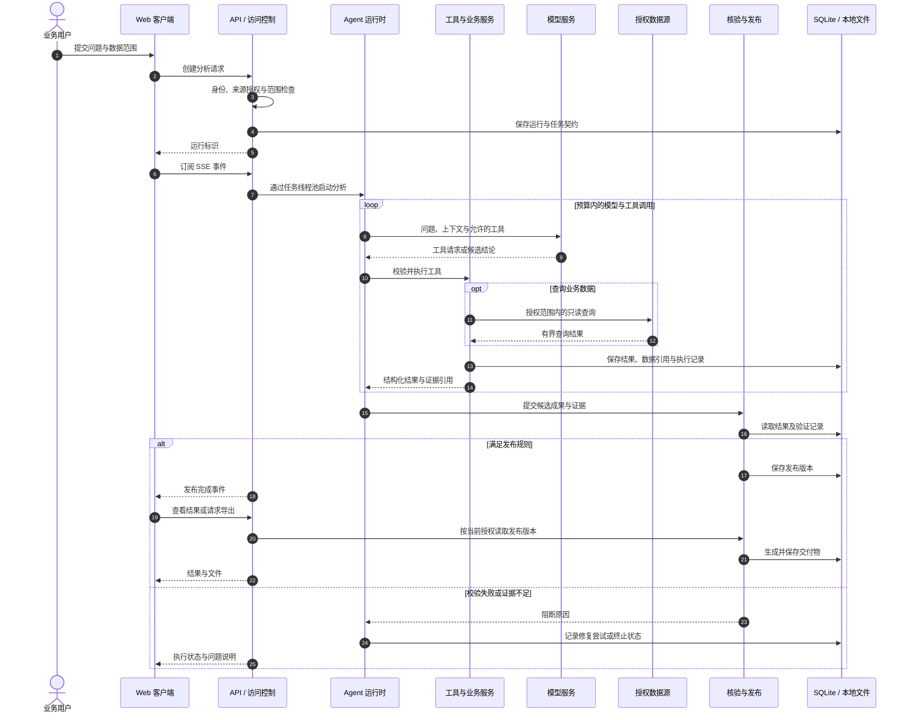
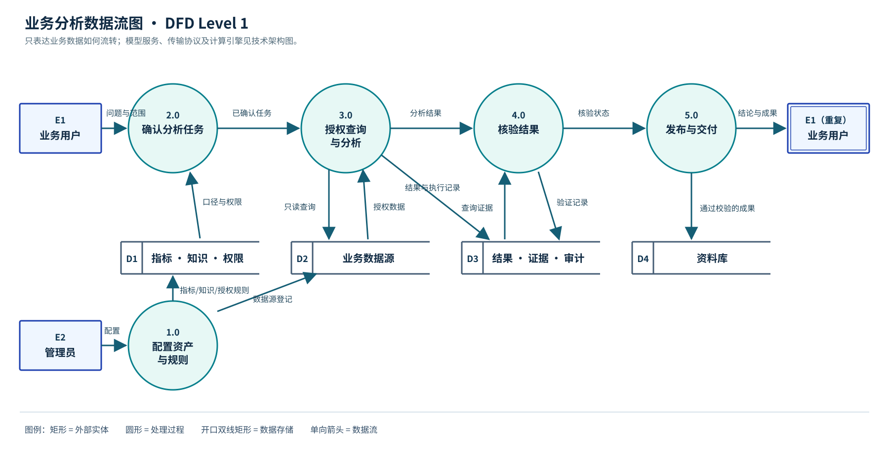

# 架构设计

[返回 README](../README.md) · [使用指南](user-guide.md) · [部署与运维](operations.md) · [开发指南](development.md)

本文描述当前仓库的实现。图中的逻辑组件对应 Python 模块，部署时由同一 Flask 应用进程加载；本地审核分析子进程和外部服务单独标注。

## 架构总览

[SVG 源文件](assets/architecture.svg) · [PNG 版本](assets/architecture.png)

该视图同时标明组件职责和当前部署边界。箭头指向被调用或读写的对象，跨系统连线标注主要协议，虚线表示可选连接。图仅展示主要关系，省略部分服务间调用和持久化连线；同一层的服务可由 API 或运行时按任务调用。

### 进程与存储

| 边界 | 当前实现 | 部署含义 |
| --- | --- | --- |
| 浏览器 | Vue 3、原生 ES Modules、ECharts | 静态依赖本地交付；生产构建预编译模板。通过 HTTP 获取数据，以 SSE 接收执行事件。 |
| 应用进程 | Flask / Waitress、API、Agent、技能、业务服务和任务线程池 | 模块之间主要通过 Python 调用协作。线程池执行后台任务，任务与事件状态写入 SQLite。 |
| 本地分析子进程 | `LocalAnalysisRunner` 与固定审核方法 | 输入通过数据规模与完整性检查，执行受超时和输出限制约束。生成的任意 Python 代码会被拒绝。 |
| 本机持久化 | SQLite WAL 与 `storage/` 下的文件 | SQLite 保存配置、运行与审计记录；文件系统保存上传数据、知识索引、查询数据及交付物。 |
| 外部系统 | 模型、业务数据源、MCP、Trino、Livy / Spark | 按配置连接，权限、网络可达性、数据流向和可用性由实际环境决定。远端计算集群由部署方提供。 |

当前进程通过 `storage/.instance.lock` 对存储目录加独占锁。多副本部署需要先迁移控制存储、任务协调和交付物存储，并重新设计跨实例的任务领取、取消与事件分发。

## 组件与源码

| 组件 | 核心源码 | 职责 |
| --- | --- | --- |
| Web 客户端 | [`frontend/src/`](../frontend/src) | 工作台、指标中心、智能体、资料库与管理后台。 |
| API 与访问控制 | [`backend/api/`](../backend/api)、[`authorization.py`](../backend/services/authorization.py)、[`backend/__init__.py`](../backend/__init__.py) | 请求校验、身份认证、工作空间与资源授权、HTTP / SSE 接口。 |
| Agent 运行时 | [`loop.py`](../backend/agent/loop.py)、[`store.py`](../backend/agent/store.py)、[`advanced_agent.py`](../backend/services/advanced_agent.py) | 单一模型与动作决策循环，维护 Run、Contract、Plan、Action、Event 与运行预算。 |
| 技能运行时 | [`backend/skills/`](../backend/skills)、[`skills/`](../skills) | 发现与解析技能，过滤权限，准备执行上下文和方法参考，限定可用工具。技能复用 Agent 循环。 |
| 工具执行器 | [`tools.py`](../backend/agent/tools.py)、[`agent_tools.py`](../backend/services/agent_tools.py) | 校验参数、检查授权与执行状态、记录动作尝试、调用工具并返回结构化结果。 |
| 任务调度 | [`jobs.py`](../backend/services/jobs.py) | 进程内线程池、任务提交、恢复与取消；运行状态持久化。 |
| 指标与业务知识 | [`semantic.py`](../backend/services/semantic.py)、[`knowledge.py`](../backend/services/knowledge.py) | 指标定义与编译、维度和单位、业务知识检索。 |
| 数据访问与计算 | [`database_queries.py`](../backend/services/database_queries.py)、[`data_plane/`](../backend/services/data_plane) | 原生数据库查询、数据引用、执行路由、本地审核分析、Trino 与 Livy 适配。 |
| 结果核验与交付 | [`validation/`](../backend/services/validation)、[`results/`](../backend/services/results) | 数据完整性与证据检查、结果清单、成果发布及多格式交付。 |
| 外部服务适配 | [`models.py`](../backend/services/models.py)、[`mcp.py`](../backend/services/mcp.py) | OpenAI 兼容模型调用、MCP 连接、鉴权与风险控制。 |
| 持久化与运行配置 | [`backend/core/`](../backend/core) | SQLite、实例锁、配置、指标与运行观测。 |

## 分析执行时序

以下为需要模型的分析路径。复杂问题在运行前可增加范围确认；纯数据浏览和指标试算由相应 API 直接调用业务服务。

模型与工具调用均受迭代次数、时长、配额和数据授权约束。SSE 传输的是执行事件，客户端可重连补取已保存事件。校验失败时，运行时可在预算内修复；仍不满足规则的结果保留运行记录和失败状态。

### 结果发布与交付

正式成果由 [`ResultService`](../backend/services/results/manifests.py) 检查来源范围、数据完整性、独立验证记录和显式数字的证据引用。结构化报告中的关键指标绑定具体查询单元格，服务端读取对应数值；指标解释保留查询时的定义、公式、单位和版本。

发布后，Word、PPT、Excel、HTML 与图片读取同一发布版本。导出复用已保存的数据与结论，不重新调用模型或查询业务数据源。读取和导出时重新检查当前授权。

规则核验通过仅表示已实现的规则满足要求。数据中存在的变化贡献、统计关系和模型解释，仍需结合业务知识判断，不能直接据此认定真实因果。

## 业务数据流

矩形表示外部实体，圆形表示处理过程，开口双线矩形表示数据存储，箭头标注传递的数据。右侧的业务用户 E1 是左侧 E1 的重复绘制。

1. 管理员登记数据源，维护指标、业务知识与授权规则。
2. 业务用户提交问题与范围，系统形成已确认的分析任务。
3. 系统结合指标和知识查询授权数据，保存结果及执行证据。
4. 核验服务读取证据并记录状态，通过发布规则后保存正式成果。
5. 业务用户查看结论或下载交付物，资料库保留成果。

此图只描述业务数据流。模型调用包含在“授权查询与分析”过程中，外部系统与进程边界见上方架构总览。

## 数据访问与计算边界

系统区分原生数据库查询、有界本地分析和显式配置的远端计算：

| 路径 | 执行位置 | 主要约束 |
| --- | --- | --- |
| 原生数据库查询与探查 | 已连接的业务数据库 | 只读 SQL、来源与行列权限、执行计划扫描预算、并发、超时、返回行数与字节限制。 |
| 有界本地统计与建模 | 应用主机的审核分析子进程 | 数据完整性、行数、单元格数、输入输出规模与超时；只运行固定审核方法。 |
| Trino 查询 | 部署方配置的 Trino 服务 | 适配器按授权数据域与操作路由；默认只读。 |
| Livy / Spark 任务 | 部署方配置的远端 Spark 环境 | 显式登记引擎、授权计算域与作业状态管理。 |

普通数据库连接按原生查询路径执行。需要全量多表扫描或大型统计建模时，应根据数据位置、计算域和实际资源配置远端引擎。

### 大型数据库接入与探查

MySQL 协议接入可识别 Doris / StarRocks，并使用对应 SQL 方言。登记连接只读取元数据，表目录支持搜索和分页；字段按选定表加载，保留类型、注释和单位。刷新目录会重新读取结构并清除本地探查缓存。历史数据库连接在首次访问时自动升级目录格式。连接表单填写主机、端口、数据库和凭据；JDBC URL 中的 Java 驱动参数不能直接作为 SQLAlchemy URL 使用。

数据探查提供元数据、样本和范围聚合三种模式。样本最多检查 5000 行、50 个字段，超出样本范围时明确标记为部分数据，统计只描述返回记录；范围聚合最多选择 10 个字段，在数据库中计算行数、缺失数和去重数。Doris / StarRocks 去重数使用近似算法，界面和 Agent 都保留准确性标记。数据库目录行数来自元数据估计，受行列权限保护时不显示全表统计。探查缓存按用户、权限、结构版本和范围隔离，有效期 120 秒。

用户可选择时间字段、格式和范围；探查结束时间为不含边界，支持 ISO、`yyyyMMdd`、`yyyyMMddHH`、Unix 秒及毫秒。语义指标中的字符串金额需要显式配置数值转换和单位系数，例如分转元使用 `decimal` 和 `0.01`；字符串时间维度需要声明格式，避免金额单位或日期比较失真。

原生数据库问数和探查将筛选、关联和聚合下推到数据源，返回结果使用流式游标，限制行数、总字节和单元格大小。每个数据库端点共享并发额度；查询先检查执行计划的扫描预算，再由超时和 Doris / StarRocks 会话内存设置约束执行。执行计划无法预估扫描量时返回明确提示，仍保留运行限制。异步查询、探查支持取消，完成前重新检查数据权限；Agent 可分页检索宽表结构并按需读取大型工具结果。

这条路径适合远端大型表的有界查询，容量取决于数据库分区、索引、资源和实际执行计划。需要全量多表扫描或大型统计建模时，应接入已配置的 Trino / Livy 执行环境；普通数据库连接不会自动切换到分布式集群。Trino 默认只读，禁止 CTAS；显式启用物化时必须使用独立的临时目录。当前应用控制面仍是单节点 SQLite 和本地文件，横向扩容需另行迁移控制存储、任务协调与交付物存储。数据库账号的只读权限由数据库管理员配置，应用查询限制不会修改账号授权。
